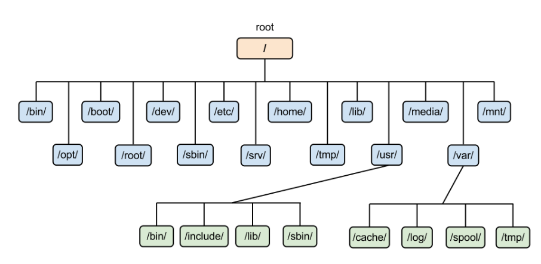

---
title: "디렉터리와 파일 사용"
draft: false
categories: ["Linux"]
tags: ["Linux"]
description: "디렉터리와 파일을 다루는 명령을 학습 "
---

## 1. 개요

리눅스에서 디렉터리와 파일을 다루는 명령을 공부한다. 디렉터리는 폴더 같은 개념이라고 생각하면 됨.
리눅스에서 작업을 수행하려면 필수적으로 디렉터리와 파일을 이용하게 되므로 쉽다고 그냥 지나치지 말고 실습을 통해 확실히 자기 것으로 만들것.

## 2. 파일의 종류

리눅스에서 파일은 사용 목적에 따라 일반 파일, 디렉터리, 심벌릭 링크, 장치 파일로 구분할 수 있다.

- 일반파일

일반 파일은 데이터를 저장하는 데 주로 사용된다. 각종 텍스트 파일, 실행 파일, 이미지 파일 등 리눅스에서 사용하는 대부분의 파일은 일반 파일에 해당한다.

- 디렉터리

리눅스에서는 디렉터리도 파일로 취급한다. 디렉터리 파일에는 해당 디렉터리에 저장된 파일이나 하위 디렉터리에 대한 정보가 저장된다.

- 심벌릭 링크

원본 파일을 대신하도록 원본 파일을 다른 파일명으로 지정한 것으로, 윈도의 바로가기 파일과 비슷하다고 보면 됨

- 장치 파일

리눅스에서는 하드디스크나 키보드 같은 각종 장치도 파일로 취급한다. 장치 파일은 리눅스 시스템에 부착된 장치를 관리하기 위한 특수 파일이다.

## 3. 디렉터리 계층 구조

리눅스에서는 파일을 효율적으로 관리하기 위해 디렉터리를 계층적으로 구성하는데 이를 트리구조라고 한다.

나무가 뿌리에서 시작하여 가지로 갈라져 각 가지에 잎이 달리고 열매가 열리는 것처럼 디렉터리도 하부 디렉터리로 나누어지고 각 디렉터리에 파일이 저장됨.

나무의 출발점이 뿌리이듯이 리눅스에서도 모든 디렉터리의 출발점은 루트(/) 디렉터리이다.



디렉터리 아래에 있는 디렉터리를 하위 디렉터리 또는 서브 디렉터리라고 함. 반대로 서브 디렉터리 위에 자신을 포함하고 있는 디렉터리를 부모 디렉터리 또는 상위 디렉터리라고 함.

## 4. 디렉터리의 주요 기능

| 디렉터리 | 기능 |
|---|---|
| dev | 장치 파일이 담긴 디렉터리 |
| home | 사용자 홈 디렉터리가 생성되는 디렉터리 |
| media | CD-ROM이나 USB 같은 외부 장치를 연결(마운트라고 함)하는 디렉터리 |
| opt | 추가 패키지가 설치되는 디렉터리 |
| root | root 계정의 홈 디렉터리. 루트(/)디렉터리와 다른 것이므로 혼동 x |
| sys | 리눅스 커널과 관련된 파일이 있는 디렉터리 |
| usr | 기본 실행 파일과 라이브러리 파일, 헤더 파일 등 많은 파일이 있다. |
| boot | 부팅에 필요한 커널 파일을 가지고 있다. |
| etc | 리눅스 설정을 위한 각종 파일을 가지고 있다. |
| lost+fount | 파일 시스템에 문제가 발생하여 복구할 경우, 문제가 되는 파일이 저장되는 디렉터리 보통은 비어 있음 |
| mnt | 파일 시스템을 임시로 마운트하는 디렉터리 |
| proc | 프로세스 정보 등 커널 관련 정보가 저장되는 디렉터리 |
| run | 실행 중인 서비스와 관련된 파일이 저장됨 |
| srv | FTP나 Web 등 시스템에서 제공하는 서비스의 데이터가 저장됨 |
| tmp | 시스템 사용 중 발생하는 임시 데이터가 저장됨 이 디렉터리에 있는 파일은 재시작하면 모두 삭제됨 |
| var | 시스템 운영 중 발생하는 데이터나 로그 등 내용이 자주 바뀌는 파일이 주로 저장됨 |

## 4. 절대 경로명과 상대 경로명

리눅스 파일 시스템에서 디렉터리 계층 구조에 있는 특정 파일이나 디렉터리의 위치를 나타내는 것을 경로명이라 함.

경로명에서 가장 앞에 있는 /은 루트 디렉터리를 뜻하지만 경로명 중간에 있는 /은 구분자이다.

1. **절대 경로명**
    - 반드시 /으로 시작
    - 루트 디렉터리부터 시작하여 특정 파일이나 디렉터리의 위치까지 이동하면서 거치게 되는 모든 중간 디렉터리의 이름을 표시
    - 특정 위치를 가리키는 절대 경로명은 항상 동일
    
    현재 디렉터리 위치가 내가 만든 사용자 user1 에 있다고 했을 때
    
    ex) /home/user1
2. ** 상대 경로명**
    - / 이외의 문자로 시작한다.
    - 현재 디렉터리를 기준으로 서브 디렉터리로 내려가면 그냥 서브 디렉터리명을 추가한다.
    - 현재 디렉터리를 기준으로 상위 디렉터리로 가려면 .. 추가
    - 상대 경로명은 현재 디렉터리가 어디냐에 따라 달라짐.

    현재 디렉터리 위치가 내가 만든 사용자 user1 에 있다고 가정하고 /bin의 경로명
    
    ex) ../../usr/bin

## 5. 디렉터리 사용 명령

| 명령어 | 기능 |
|---|---|
| pwd | 현재 작업 디렉터리 확인 |
| cd | 작업 디렉터리 이동 |
| ls | 파일 및 디렉터리 목록 확인 |
| mkdir | 디렉터리 생성 |
| rmdir | 비어 있는 디렉터리 삭제 |

### pwd (Print Working Directory)

현재 작업 중인 디렉터리의 절대 경로를 출력하는 명령어

**기본 사용법**

```bash
pwd
```

**실행 결과 예시**

```text
/home/user
```

### cd (Change Directory)

현재 작업 디렉터리를 다른 디렉터리로 이동하는 명령어

**기본 사용법**

```bash
cd [디렉터리 경로]
```

**주요 사용 방법**

| 명령어 | 설명 |
|---|---|
| cd / | 루트 디렉터리로 이동 |
| cd ~ | 사용자 홈 디렉터리로 이동 |
| cd .. | 상위 디렉터리로 이동 |
| cd . | 현재 디렉터리 유지 |
| cd - | 이전 작업 디렉터리로 이동 |

**사용 예시**

```bash
cd /etc
pwd
```

### ls (List)

현재 또는 지정한 디렉터리의 파일과 디렉터리 목록을
출력하는 명령어

**기본 사용법**

```bash
ls [옵션] [경로]
```

**주요 옵션**

| 옵션 | 설명 |
|---|---|
| -l | 상세 정보 출력 |
| -a | 숨김 파일을 포함한 전체 목록 출력 |
| -h | 파일 크기를 읽기 쉬운 단위로 출력 |
| -R | 하위 디렉터리까지 재귀적으로 출력 |
| -t | 수정 시간 기준으로 정렬 |
| -r | 정렬 순서를 역순으로 변경 |

**사용 예시**

```bash
ls -al
ls -lh
ls -alh /etc
```

### mkdir (Make Directory)

새로운 디렉터리를 생성하는 명령어

**기본 사용법**

```bash
mkdir [디렉터리 이름]
```

**주요 옵션**

| 옵션 | 설명 |
|---|---|
| -p | 필요한 상위 디렉터리까지 생성 |
| -v | 디렉터리 생성 과정 출력 |
| -m | 생성할 디렉터리의 권한 지정 |

**사용 예시**

```bash
mkdir test
mkdir -p project/web/logs
mkdir -m 755 test-dir
```

### rmdir (Remove Directory)

비어 있는 디렉터리를 삭제하는 명령어

**기본 사용법**

```bash
rmdir [디렉터리 이름]
```

**사용 예시**

```bash
rmdir test
```

파일이나 하위 디렉터리가 존재하는 경우 삭제할 수 없다.


## 6. 파일 사용 명령

| 명령어 | 기능 |
|---|---|
| touch | 빈 파일 생성 및 시간 정보 변경 |
| cp | 파일 및 디렉터리 복사 |
| mv | 파일 이동 및 이름 변경 |
| rm | 파일 및 디렉터리 삭제 |
| cat | 파일 내용 전체 출력 |
| more | 파일 내용을 화면 단위로 출력 |
| less | 파일 내용을 앞뒤로 이동하며 확인 |
| head | 파일의 앞부분 출력 |
| tail | 파일의 뒷부분 출력 |
| file | 파일의 유형 확인 |

### touch

파일이 존재하지 않을 경우 빈 파일을 생성하고,
이미 존재하는 경우 파일의 시간 정보를 갱신하는 명령어

**기본 사용법**

```bash
touch [옵션] [파일명]
```

**주요 옵션**

| 옵션 | 설명 |
|---|---|
| -a | 접근 시간 변경 |
| -m | 수정 시간 변경 |
| -c | 파일이 존재하지 않을 경우 생성하지 않음 |
| -t | 지정한 시간으로 변경 |

**사용 예시**

```bash
touch test.txt
touch file1.txt file2.txt
touch -m test.txt
```

---

### cp (Copy)

파일 또는 디렉터리를 다른 위치에 복사하는 명령어

원본 파일은 유지되며 새로운 복사본이 생성된다.

**기본 사용법**

```bash
cp [옵션] [원본] [대상]
```

**주요 옵션**

| 옵션 | 설명 |
|---|---|
| -i | 덮어쓰기 전 사용자에게 확인 |
| -f | 필요한 경우 기존 대상 파일을 제거하고 복사 |
| -r | 하위 디렉터리를 포함하여 재귀적으로 복사 |
| -p | 파일의 권한, 소유권, 시간 정보 보존 |
| -v | 복사 과정 출력 |
| -a | 디렉터리 구조와 파일 속성을 최대한 유지하여 복사 |

**사용 예시**

```bash
cp test.txt backup.txt
cp test.txt /tmp/
cp -r project backup-project
cp -p config.conf backup.conf
```

---

### mv (Move)

파일 또는 디렉터리를 다른 위치로 이동하거나
이름을 변경하는 명령어

**기본 사용법**

```bash
mv [옵션] [원본] [대상]
```

**주요 옵션**

| 옵션 | 설명 |
|---|---|
| -i | 덮어쓰기 전 사용자에게 확인 |
| -f | 덮어쓰기 확인 없이 실행 |
| -n | 대상 파일이 존재하면 덮어쓰지 않음 |
| -v | 이동 과정 출력 |

**사용 예시**

```bash
# 파일 이름 변경
mv old.txt new.txt

# 파일 이동
mv test.txt /tmp/

# 디렉터리 이름 변경
mv old-dir new-dir
```

cp는 원본 파일을 유지하지만,
mv는 원본 경로에서 파일이 사라진다는 차이가 있다.

---

### rm (Remove)

파일 또는 디렉터리를 삭제하는 명령어

**기본 사용법**

```bash
rm [옵션] [파일명]
```

**주요 옵션**

| 옵션 | 설명 |
|---|---|
| -i | 삭제 전 사용자에게 확인 |
| -f | 사용자 확인 없이 삭제 |
| -r | 하위 디렉터리 및 파일을 재귀적으로 삭제 |
| -v | 삭제 과정 출력 |

**사용 예시**

```bash
rm test.txt
rm -i test.txt
rm -r test-dir
rm -ri test-dir
```

**주의사항**

rm 명령어로 삭제한 파일은 일반적으로
휴지통으로 이동하지 않는다.

특히 -r과 -f 옵션을 함께 사용하면
하위 디렉터리와 파일까지 확인 없이 삭제할 수 있으므로
실행 전 대상 경로를 반드시 확인해야 한다.

---

### cat (Concatenate)

파일의 내용을 표준 출력으로 출력하거나
여러 파일의 내용을 연결하는 명령어

**기본 사용법**

```bash
cat [옵션] [파일명]
```

**주요 옵션**

| 옵션 | 설명 |
|---|---|
| -n | 모든 줄에 줄 번호 표시 |
| -b | 비어 있지 않은 줄에만 줄 번호 표시 |
| -s | 연속된 빈 줄을 하나로 표시 |
| -E | 각 줄의 끝에 $ 표시 |
| -T | 탭 문자를 ^I로 표시 |

**사용 예시**

```bash
cat test.txt
cat -n test.txt
cat file1.txt file2.txt
```

**여러 파일의 내용을 하나로 합치기**

```bash
cat file1.txt file2.txt > result.txt
```

---

### more

파일의 내용을 한 화면씩 나누어 확인하는 명령어

내용이 긴 파일을 확인할 때 사용한다.

**기본 사용법**

```bash
more [파일명]
```

**주요 조작 방법**

| 키 | 설명 |
|---|---|
| Space | 다음 화면으로 이동 |
| Enter | 다음 줄로 이동 |
| /문자열 | 문자열 검색 |
| q | 종료 |

**사용 예시**

```bash
more /etc/passwd
```

---

### less

파일 내용을 화면 단위로 확인하고
앞뒤 이동 및 문자열 검색을 수행하는 명령어

more보다 편리하게 파일 내용을 탐색할 수 있다.

**기본 사용법**

```bash
less [파일명]
```

**주요 조작 방법**

| 키 | 설명 |
|---|---|
| Space | 다음 화면으로 이동 |
| b | 이전 화면으로 이동 |
| g | 파일의 처음으로 이동 |
| G | 파일의 마지막으로 이동 |
| /문자열 | 문자열 검색 |
| n | 다음 검색 결과로 이동 |
| N | 이전 검색 결과로 이동 |
| q | 종료 |

**사용 예시**

```bash
less /etc/passwd
less /etc/services
```

---

### head

파일의 앞부분을 출력하는 명령어

기본적으로 파일의 처음 10줄을 출력한다.

**기본 사용법**

```bash
head [옵션] [파일명]
```

**주요 옵션**

| 옵션 | 설명 |
|---|---|
| -n | 출력할 줄 수 지정 |
| -c | 출력할 바이트 수 지정 |

**사용 예시**

```bash
head test.txt
head -n 5 test.txt
head -n 20 /etc/passwd
```

---

### tail

파일의 뒷부분을 출력하는 명령어

기본적으로 파일의 마지막 10줄을 출력한다.

**기본 사용법**

```bash
tail [옵션] [파일명]
```

**주요 옵션**

| 옵션 | 설명 |
|---|---|
| -n | 출력할 줄 수 지정 |
| -c | 출력할 바이트 수 지정 |
| -f | 파일에 추가되는 내용을 지속적으로 출력 |
| -F | 파일 교체 및 재생성 시에도 추적 시도 |

**사용 예시**

```bash
tail test.txt
tail -n 20 test.txt
tail -f /var/log/nginx/access.log
```

tail -f는 서비스 운영 중 로그 파일에 추가되는 내용을
실시간으로 확인할 때 사용한다.

실행을 종료하려면 Ctrl + C를 입력한다.

---

### file

파일의 내용과 특성 등을 분석하여
파일의 유형을 확인하는 명령어

**기본 사용법**

```bash
file [파일명]
```

**사용 예시**

```bash
file test.txt
file /etc/passwd
file /bin/bash
```

텍스트 파일, 실행 파일, 이미지, 압축 파일 등의
유형을 확인할 수 있다.

---

## 7. 정리
- 파일의 종류: 

  일반 파일: 데이터를 저장하는 데 주로 사용되며, 텍스트 파일과 바이너리 파일이 있다.
  디렉터리: 파일 시스템을 계층적으로 구성하기 위한 특수 파일이다.
  심벌릭 링크: 다른 파일을 가리키는 특수 파일로, 원본 파일의 경로를 파일 내용에 담고 있다.
  장치 파일: 리눅스 시스템에 부착된 장치를 관리하기 위한 특수 파일이다.

- 경로의 종류: 

  절대 경로: 루트 디렉터리를 기준으로 파일의 위치를 나타낸 것, 항상 /으로 시작
  상대 경로: 현재 위치를 기준으로 파일의 위치를 나타낸 것, / 이외의 문자로 시작하며 상위 디렉터리는 ..로 표시

- 디렉터리 사용 명령, 파일 사용 명령 실습

## 8. 참고 자료
- 도서명: 페도라 리눅스
  저자: 이종원
  출판사: 한빛아카데미
  참고 범위: Chapter02 (p.98~150)